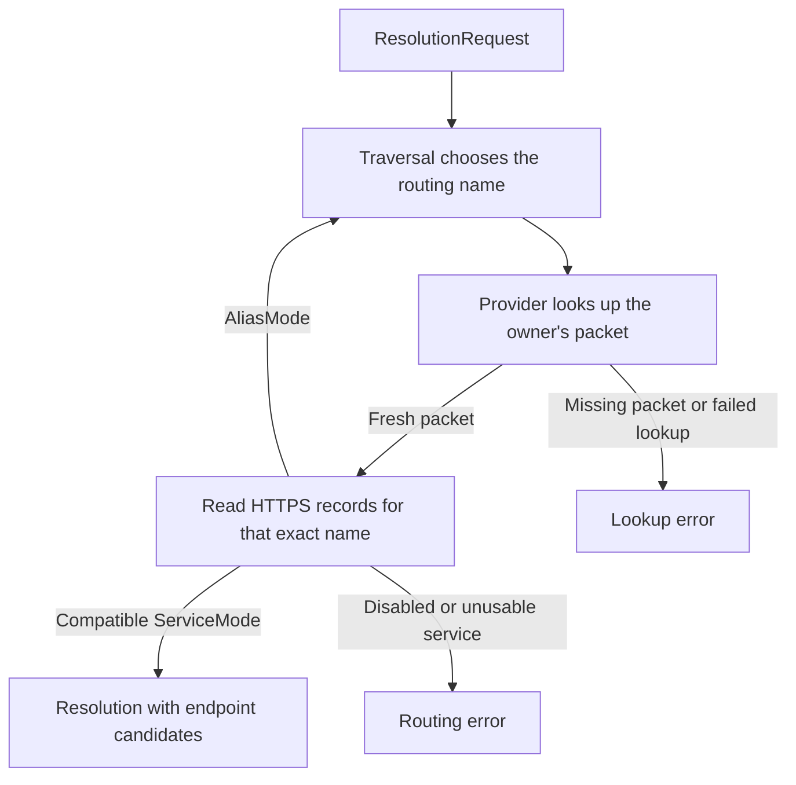

# How pkresolve resolves a service

Given a Pubky service name, a URL port, and the protocols a client speaks,
`pkresolve` answers two questions. Where can the client connect? Which raw
TLS public key must the peer prove it owns?

The relay and the client run the same resolver with different packet sources.
The relay looks up signed PKARR packets in its cache or on the DHT and returns
the packets it used. The client verifies their signatures and runs the resolver
locally with the original request. The application opens the connection and
authenticates the peer.

## Four parts of the resolver

1. **Request and result.** A `ServiceName` pairs an exact name such as
   `app.<key>` with the public key that owns it. A `ResolutionRequest` adds
   the URL port and the client's HTTP protocol preferences. A `Resolution`
   keeps the original service and port, the required TLS key, the endpoint
   candidates, and their shared expiry. [Service names][names] ·
   [Request and result types][types]
2. **Packet lookup.** A `PacketProvider` supplies a validated packet for an
   owner key. A map of verified packets implements this interface directly.
   The relay uses an `AsyncPacketProvider` for lookups that may need network
   I/O. Both must supply the same packet version for repeated lookups of an
   owner during one traversal. [Provider traits][providers]
3. **Traversal across packets.** `derive_resolution` and
   `derive_resolution_async` drive the same loop. It requests the next
   owner's packet, checks freshness, and follows aliases. It rejects loops,
   visits at most 32 routing names, and retains the earliest packet expiry.
   [Entry points][drivers] · [Traversal state][traversal]
4. **Routing within a packet.** An HTTPS AliasMode record names the next
   service to inspect. A ServiceMode record describes a connection. The
   resolver selects records compatible with HTTP/1.1 or HTTP/2, combines
   signed addresses and address hints, and returns candidates in priority
   order. Each candidate has its own connection port and compatible protocols.
   [Routing rules][routing] · [HTTPS record selection][records]

## What the Cargo features add

- **Default build.** Both resolver entry points and both provider traits are
  available. Use this build when your application supplies the packets.
- **`service-protocol`.** Adds Serde support for the wire format. A
  `ResolveBundle` carries packets and the relay's resolution summary. A
  `ResolveErrorBundle` carries the packets obtained before a failure and the
  relay's diagnostic. The HTTP handler lives in `pkarr-relay`.
  [Wire types][protocol] · [Relay handler][handler]
- **`service-client`.** Includes `service-protocol` and adds `ServiceClient`.
  Its `prepare()` method tries the local packet cache. If a packet is missing
  or expired, the host sends the prepared HTTP request. Its `accept_bundle()`
  method verifies the packets and replays the original request using only
  those packets. A successful resolution populates the cache.
  [Client implementation][client]

## Follow one alias

Suppose a client requests `app.A` on port 443, where A and B stand for
public keys. A's packet contains an HTTPS alias from `app.A` to `edge.B`.
B's packet contains a compatible ServiceMode record for `edge.B` with
connection port 8443 and a signed address.

The client connects to that address on **8443**. It keeps **`app.A`** as
the TLS server name and preserves the original HTTP authority. It requires
the peer to authenticate with **B's key**. The earlier expiry of A's and B's
packets limits how long the client can reuse this result.

The same chain illustrates two different failures. If B's signed record
disables the service, the relay returns both packets and the client can
independently derive `ServiceUnavailable`. If the relay times out fetching
B, it returns A's packet. The client can verify A's delegation and identify
B as the missing owner in `IncompleteBundle`. The timeout itself is the
relay's observation. [Relay response examples][http] · [End-to-end tests][tests]

[names]: ../pkresolve/src/service_name.rs
[types]: ../pkresolve/src/resolution/types.rs
[providers]: ../pkresolve/src/provider.rs
[drivers]: ../pkresolve/src/resolution/resolve.rs
[traversal]: ../pkresolve/src/resolution/traversal.rs
[routing]: ../pkresolve/src/resolution/routing.rs
[records]: ../pkresolve/src/resolution/https_records.rs
[protocol]: ../pkresolve/src/service_protocol.rs
[handler]: ../relay/src/resolve.rs
[client]: ../pkresolve/src/service_client.rs
[http]: relay-resolve.md
[tests]: ../relay/src/resolve/tests.rs
